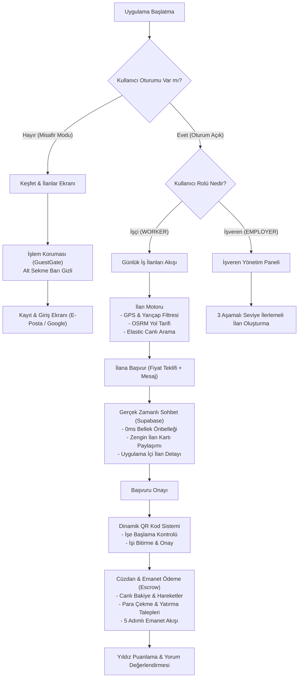
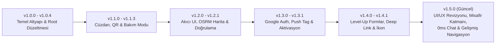
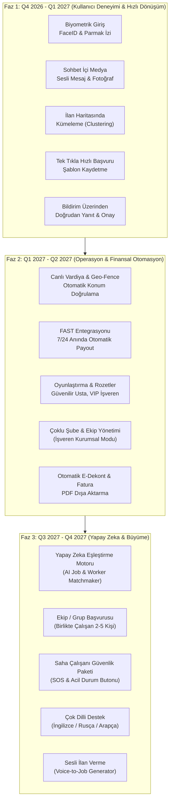

# Günübirlik Mobil — Resmi Mobil Uygulaması

> **Günübirlik:** Türkiye'nin yeni nesil, güvenilir, anlık günlük yevmiyeli iş bulma, çalışan temini ve emanet hesap (escrow) ödeme platformu.

React Native (Expo SDK 57) mimarisi üzerinde inşa edilmiş, hem Android hem iOS platformlarında sıfır gecikme (0 ms) performansıyla çalışan resmi mobil istemci.

---

## 📌 İçindekiler
1. [Teknoloji Yığını & Mimari](#-teknoloji-yığını--mimari)
2. [Uygulama Sistem Mimarisi](#-uygulama-sistem-mimarisi)
3. [Zaman Çizelgesi: Yapılanlar & Gelişim Süreci](#-zaman-çizelgesi-yapılanlar--gelişim-süreci)
4. [Gelecek Yol Haritası (Roadmap)](#-gelecek-yol-haritası-roadmap)
5. [Önerilen Zengin Özellikler Kataloğu](#-önerilen-zengin-özellikler-kataloğu)
6. [Kurulum & Geliştirme Rehberi](#-kurulum--geliştirme-rehberi)
7. [Proje Dizin Yapısı](#-proje-dizin-yapısı)

---

## 🛠 Teknoloji Yığını & Mimari

| Katman | Teknoloji / Kütüphane | Amaç & Kullanım |
|---|---|---|
| **Çekirdek Çatı** | React Native 0.86 & Expo SDK 57 | Modern, yüksek performanslı cross-platform mobil çekirdek |
| **Dil & Tip Güvenliği** | TypeScript 5.7 & Strict Mode | Uçtan uca tip güvenliği ve derleme zamanı hata denetimi |
| **Tasarım Sistemi** | Custom Plus Jakarta Sans & Lucide Icons | Premium tipografi, erişilebilir renk paleti, yapay zeka şablonundan uzak özel UI/UX |
| **Ağ & API** | Axios + InMemory/AsyncStorage Cache-First | Hızlı açılış, sıfır bekleme, akıllı hata yönetimi |
| **Gerçek Zamanlı Sohbet** | Supabase Realtime (WebSockets) | Çift yönlü gerçek zamanlı mesajlaşma, yazıyor göstergesi, anlık durum güncellemeleri |
| **Harita & Rota** | Leaflet + OpenStreetMap + OSRM Routing | Cihaz GPS'i üzerinden uygulama içi canlı yol tarifi ve mesafe hesabı |
| **Bildirim & Derin Bağlantı** | OneSignal SDK (v5.2.17) + Custom Scheme | Hedefli push bildirimleri ve uygulama içi doğrudan rota (`gunubirlik://`) |
| **Diyalog & Etkileşim** | `react-native-modal` + Custom AppDialog | İşletim sisteminin ham diyalogları yerine animasyonlu, zarif popup deneyimi |
| **Doğrulama & Donanım** | Expo Camera + `react-native-qrcode-svg` | İşçi & işveren için QR kodlu işe başlama ve bitirme kontrolü |

---

## 📐 Uygulama Sistem Mimarisi

Aşağıdaki şema, kullanıcının uygulamaya girişinden iş tamamlama ve ödeme sürecine kadar olan uçtan uca mimari akışını göstermektedir:



---

## ⏱ Zaman Çizelgesi: Yapılanlar & Gelişim Süreci

Günübirlik Mobil projesinde bugüne kadar hayata geçirilen tüm ana kilometre taşları ve versiyon evrimi:



### 📅 Tarihsel Detay Tablosu

| Versiyon | Tarih / Dönem | Tamamlanan Ana Özellikler & Çözümler |
|---|---|---|
| **v1.0.x** | *Eylül 2026* | • React Native / Expo çekirdek projesinin ayağa kaldırılması.<br>• Android release `registerRootComponent` ve beyaz ekran hata izolasyonu.<br>• Temel API istemcisi ve oturum yönetimi. |
| **v1.1.x** | *Ekim 2026 (Başı)* | • Canlı bakiye, para yatırma/çekme, havale ve emanet akışlı **Cüzdan Ekranı**.<br>• İşe başlama/bitirme için dinamik token'lı **QR Kod Tarayıcı & Üretici**.<br>• Kapsamlı **Ayarlar Merkezi** (Güvenlik, Bildirim Tercihleri, Politikalar).<br>• Uzaktan yönetilebilir acil durum **Bakım Modu Ekranı**. |
| **v1.2.x** | *Ekim 2026 (Ortası)* | • Harici Google Maps yerine Leaflet + **OSRM motoru ile uygulama içi canlı yol tarifi**.<br>• İşçi istatistik kartları, tamamlanan işler, puan özeti ve yıldız barları.<br>• Kimlik/belge yükleme ile güvenli doğrulama talebi (`verification-request`).<br>• Ön bellekten okuyan anlık (cache-first) bildirim ve bakiye yapılandırması. |
| **v1.3.x** | *Ekim 2026* | • `@react-native-google-signin` ile tek tıkla **Google ile Giriş / Kayıt**.<br>• OneSignal bildirim alt yapısı, cihaz etiketi (`gbUserId`) ve push aboneliği.<br>• 6 haneli e-posta OTP aktivasyon ve şifre sıfırlama akışları. |
| **v1.4.x** | *Ekim 2026* | • 3 adımlı ilerleme çubuklu **Level-Up Formlar** (Kayıt ve İlan Verme).<br>• Bildirim tıklandığında doğrudan ilgili sayfayı açan **Push Deep Linking** (`gunubirlik://`).<br>• Yeni degrade amblemli squircle uygulama ikonu ve şeffaf splash ekranı. |
| **v1.5.0** *(Güncel)* | *Ekim 2026* | • **Hesap & Profil UI/UX Revizyonu:** Aşırı parlak renkler kaldırıldı; sofistike, dengeli ve modern bir tasarım sistemi kuruldu.<br>• **Bildirimlerde Yapay Zeka Emojilerinin Temizlenmesi:** Bildirim metinleri ve bildirim ayarları sadeleştirildi; Lucide ikonları ile profesyonel görünüm sağlandı.<br>• **Misafir Modu & Koruması:** Giriş yapmamış kullanıcılar için alt sekme barı gizlendi, yetkisiz alanlara `GuestGate` eklendi, üst bildirim ikonu gizlendi.<br>• **Modern Popup Diyalog Kütüphanesi:** Çirkin sistem `Alert.alert` çağrıları `AppDialogProvider` ve `react-native-modal` ile şık açılır pencerelere dönüştürüldü.<br>• **Saha Rehberi & Blog:** Webview ve interaktif carousel ile `gunubirlik.qrders.com.tr/blog` içerikleri doğrudan uygulamaya bağlandı.<br>• **Android Donanım Geri Tuşu Yönetimi:** Geri tuşuna basıldığında doğrudan uygulamadan çıkış engellendi; gezilen sekme geçmişine dönme, açık modalları kapatma ve ana sayfada çift tıklamayla güvenli çıkış eklendi.<br>• **Sohbet 0 ms Optimizasyonu:** Çift yükleme sorunu giderildi; konuşmalar ve geçmiş mesajlar RAM/disk önbelleğine arka planda çekilerek (prefetch) anında açılış sağlandı.<br>• **Sohbette İlan Paylaşımı İyileştirmesi:** Paylaşılan iş kartlarına dokunulduğunda dış tarayıcı yerine doğrudan uygulama içi yerel `JobDetailScreen` ekranı açıldı. |

---

## 🗺 Gelecek Yol Haritası (Roadmap)

Günübirlik uygulamasını Türkiye ve bölgenin en gelişmiş esnek iş gücü platformuna dönüştürecek 4 fazlı stratejik yol haritası:



---

## 💡 Önerilen Zengin Özellikler Kataloğu

Uygulamanın rekabet avantajını katlayacak detaylı özellik önerileri:

### 1. Güvenlik & Doğrulama İnovasyonları
* **Biyometrik Giriş (Biometric Auth):** Expo LocalAuthentication entegrasyonu ile FaceID veya parmak izi okutarak her seferinde şifre girmeden 1 saniyede oturum açma.
* **Canlı Canlılık Testi (Liveness Verification):** Sahte profilleri engellemek amacıyla selfie çekimi esnasında göz kırpma ve baş çevirme algoritmalarıyla gerçek işçi doğrulaması.
* **Saha Güvenliği & Acil Durum (SOS Butonu):** Gece vardiyasında veya ıssız lokasyonlarda çalışan günübirlikçiler için tek dokunuşla canlı konum bilgisini acil durum irtibat kişilerine ve merkeze SMS/Push ile iletme.

### 2. Akıllı İş & Eşleştirme (AI Matchmaking)
* **Akıllı İş Tavsiyesi:** Çalışanın tamamladığı iş türlerine, ortalama aldığı puana ve ev adresine olan toplu taşıma/yol mesafesine göre kişiselleştirilmiş "Bugün Sana En Uygun İşler" akışı.
* **Yapay Zeka ile İlan Yazma (AI Job Wizard):** İşverenin "Yarın Kadıköy'de kafeme 2 bulaşıkçı lazım, günlük 1200 TL" demesiyle ilanın başlığını, açıklamasını, gerekli ekipmanları ve lokasyonunu otomatik dolduran asistan.
* **İşçi Becerileri Portföyü:** Çalışanların yaptığı işlerden görsel yükleyebileceği mini portföy galerisi (örneğin boyacıların bitirdiği duvarlar, garsonların etkinlik fotoğrafları).

### 3. Finans, Ödeme & Cüzdan Derinleştirmesi
* **FAST & Anlık Banka Transferi:** Manuel onay sürecini minimize eden, mesai saati fark etmeksizin 7/24 çalışanın IBAN'ına anında yansıyan otomatik ödeme altyapısı.
* **Günübirlik Avans / Erken Ödeme:** Yüksek puanlı ve güvenilir işçiler için iş tamamlandığı anda onay beklemeden %50 erken nakit çekim desteği.
* **Dijital Bahşiş (Tip System):** İşverenlerin memnun kaldıkları personele QR üzerinden veya uygulama içi tek tıkla ek bahşiş gönderebilmesi.

### 4. Saha Operasyonu & Vardiya Takibi
* **Geo-Fencing Otomatik Check-in:** Çalışan iş yerine 100 metre yaklaştığında vardiyasının başladığını, ayrıldığında bittiğini GPS ile otomatik tespit eden akıllı zaman kartı.
* **Mola & Fazla Mesai Sayacı:** Beklenenden uzun süren işlerde geçen ek saatlerin saatlik ücret üzerinden otomatik olarak faturaya ve çalışanın kazancına eklenmesi.
* **Grup / Ekip Başvurusu:** 3-4 arkadaşın festival, fuar veya büyük inşaat işlerine "Tek Ekip Olarak Başvur" seçeneğiyle birlikte teklif verebilmesi.

### 5. Etkileşim & İletişim Genişletmesi
* **Sohbet İçi Ses Kaydı:** Sahada elleri kirli veya meşgul olan ustalar için WhatsApp benzeri bas-konuş sesli mesaj desteği.
* **Canlı Konum Paylaşımı:** İş yerine giderken "Yoldayım, 10 dakikaya oradayım" durumunu gösteren 30 dakikalık geçici canlı konum akışı.
* **Hızlı Aksiyon Butonlu Bildirimler:** Gelen iş teklifini veya başvurusunu uygulamayı açmadan doğrudan kilit ekranındaki "Kabul Et" veya "Reddet" butonlarına basarak yönetme.

---

## 🚀 Kurulum & Geliştirme Rehberi

### Gereksinimler
- Node.js 18+ veya Bun
- Expo CLI (`bunx expo` veya `npx expo`)
- Mobil cihazda **Expo Go** uygulaması (Android / iOS)

### 1. Bağımlılıkları Yükleyin
```bash
# Proje kök dizininde:
npm install
# veya
bun install
```

### 2. Geliştirme Sunucusunu Başlatın
```bash
# Yerel ağda Expo Go Metro sunucusunu başlat:
npm run start

# Farklı ağlardaysanız (Tunnel modu ile doğrudan bağlantı):
npm run tunnel
```

### 3. Tip Kontrolü
```bash
npm run typecheck
```

### 4. Canlı Test Hesapları
Geliştirme ve test süreçlerinde backend üzerinde tanımlı hazır hesaplar:
* **İşçi Rolü:** `worker1@example.com` / `123456`
* **İşveren Rolü:** `ahmet@insaat.com` / `123456`

---

## 📂 Proje Dizin Yapısı

```
gunubirlik-m-w/
├── App.tsx                      # Root uygulama başlatıcı & Crash Reporter
├── RealApp.tsx                  # Ana Tab Bar, Modal ve Navigasyon Yöneticisi
├── app.json                     # Expo & Native proje konfigürasyonu
├── package.json                 # Bağımlılıklar ve npm betikleri
├── src/
│   ├── components/              # Yeniden kullanılabilir UI bileşenleri
│   │   ├── AnimatedSplashScreen.tsx  # Şeffaf geçişli açılış animasyonu
│   │   ├── AnimatedTabBar.tsx        # Rol bazlı modern alt navigasyon
│   │   ├── AppDialog.tsx             # Global animasyonlu modal popup sistemi
│   │   ├── AppHeader.tsx             # Başlık, bakiye ve bildirim ikonu
│   │   ├── BlogCarousel.tsx          # Saha rehberi kartları
│   │   ├── BlogWebViewModal.tsx      # Uygulama içi blog tarayıcısı
│   │   ├── BrandPullToRefresh.tsx    # Özel çek-bırak yenileme bileşeni
│   │   ├── GuestGate.tsx             # Giriş yapmamış kullanıcı koruma kartı
│   │   ├── icons.tsx                 # Özelleştirilmiş Lucide SVG ikon seti
│   │   └── ui.tsx                    # Tema, renkler, butonlar, kartlar
│   ├── hooks/                   # Özel React kancaları
│   │   ├── use-auth.tsx              # Oturum yönetimi & kullanıcı durumu
│   │   └── use-cached-list.ts        # Cache-first liste optimizasyon kancası
│   ├── lib/                     # Yardımcı kütüphaneler & Entegrasyonlar
│   │   ├── api.ts                    # Backend REST API istemcisi
│   │   ├── blog-service.ts           # Blog & rehber veri servisi
│   │   ├── elasticJobSearch.ts       # Anlık yerel ilan arama motoru
│   │   ├── google-auth.ts            # Google Sign-In yapılandırması
│   │   ├── onesignal.ts              # OneSignal Push Bildirim entegrasyonu
│   │   ├── saved-store.ts            # Kaydedilen ilanlar durum yöneticisi
│   │   ├── socket.ts                 # Supabase Realtime WebSocket yöneticisi
│   │   └── types.ts                  # Ortak TypeScript tip tanımları
│   └── screens/                 # Uygulama ana ekranları
│       ├── ApplicationsScreen.tsx    # Başvurularım & onay durumları
│       ├── AuthScreen.tsx            # Giriş, kayıt ve seviyeli formlar
│       ├── DashboardScreen.tsx       # İşveren yönetim & ilan verme paneli
│       ├── JobDetailScreen.tsx       # İlan detayı, rota ve başvuru
│       ├── JobsScreen.tsx            # İşçi ilan akışı & harita
│       ├── MaintenanceScreen.tsx     # Uzaktan bakım modu ekranı
│       ├── MessagesScreen.tsx        # 0 ms anlık sohbet & ilan paylaşımı
│       ├── NotificationsScreen.tsx   # Bildirim merkezi & filtreler
│       ├── ProfileScreen.tsx         # Hesap, cüzdan, güvenlik & ayarlar
│       ├── QRScreen.tsx              # İşe başlama/bitirme QR gösterici
│       └── QrScannerScreen.tsx       # Kamera ile QR tarama ekranı
```

---

<p align="center">
  <b>Günübirlik Mobile</b> · Türkiye'nin Günlük İş Gücü Platformu
</p>
